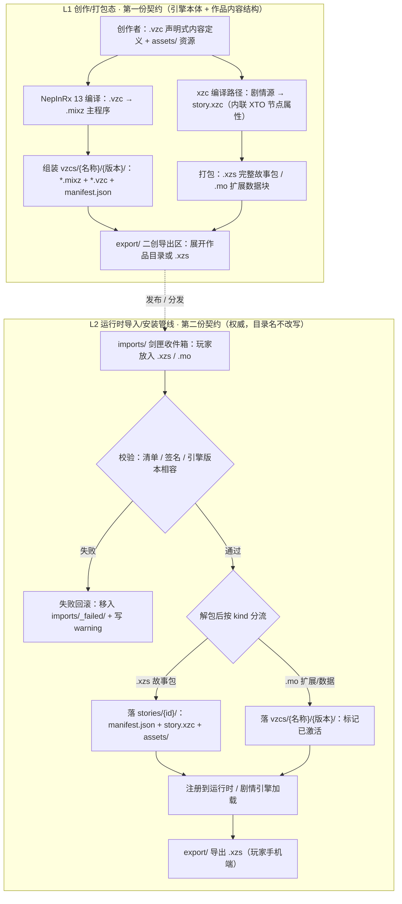
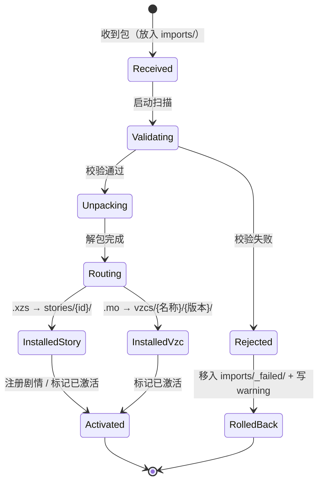

# XsureZrcnmve 3.0 · 统一架构说明

> 文档编号：B1-D1　|　交付角色：工程技术与引擎工程师（程基岩 / engineering-lead-3）
> 状态：交付稿　|　评审强度：lean
> 适用范围：**Windows 桌面为本次主实现目标**（用户裁定）；安卓端仅作契约参考，延后实现
> 根路径：`E:\XIEMI\XsureZrcnmve`（下称「XZ 根目录」）
>
> 知识诚实声明：`.mixz` 二进制格式、`engine_version` 取值规范、`.xzs`/`.mo` 容器内部布局、
> `xto.fallback` 各令牌的精确语义，均**未由公开规范确认**。本文只描述已确证的事实与
> 保守的防御性解释，所有不确定处均显式标注「知识缺口」，不臆造格式与 API。

---

## 0. 三视角合为一份文档（不互斥硬选）

用户在「契约关系」上同时选择了「两层互补 / 第二份为准 / 双端两套」。三者不是三选一，
而是**同一架构的三个观察面**：结构面、生命周期面、平台面。本文按一份文档覆盖三视角。

| 视角 | 观察面 | 在本文中的落点 | 权威性 |
| --- | --- | --- | --- |
| ① 两层互补（主线） | 结构 | 第一份契约 = **创作/打包态**（引擎本体 + 二创作品内容结构，第 3 节 L1）；第二份契约 = **运行时导入安装管线**（玩家运行态，第 3 节 L2）。两层前后衔接，不是二选一 | 主线定义 |
| ② 第二份为准 | 生命周期 | 运行时层的 `imports/` → `stories/` → `vzcs/` → `export/` 生命周期**严格按第二份写，目录名不改写**（第 3、6、7 节）。第一份在运行时层不产生同名目录冲突 | **运行时层权威** |
| ③ 双端两套 | 平台 | 附录第 11 节：桌面路径与安卓 `/Android/data/包名/files/` 的路径、权限、可写性逐项映射；桌面实现、安卓延后 | 平台差异附录 |

**自洽性说明**：第一份与第二份都出现 `export/`、`data/saves/`，但语义是同一目录在不同态的两种形态，
不是两个互斥目录：

- `export/`：创作/打包态承载**展开的作品目录** `邪冥的日常_第一章/{manifest.json, story.xzc}`；
  运行态承载**打包容器** `<作品名>.xzs`。二者可并存，导入管线优先识别 `.xzs`（第 7 节）。
- `data/saves/`：两份契约一致，均存放 `slot_01.sav` / `slot_02.sav`。
- `assets/`：第一份的根级 `assets/` = **引擎自带资源**；第二份的 `stories/{id}/assets/` =
  **作品包自带资源**。资源解析器按「作品优先、引擎兜底」顺序查找，不冲突。

---

## 1. 现状与本文定位

现状为 **WPF + WebView2 桌面原型** + **`Core_Dimension`（three.js + three-vrm 3D 观测终端）**。
已确认的现有关键文件（本次先读后动，未在其列者不改）：

| 文件 | 现状职责 |
| --- | --- |
| `VZC/VzcHost.cs` | 扫描 `vzcs/{名称}/{版本}/`，读扩展级 manifest.json、版本择优、虚拟主机映射、注册表桥接，`Activate()` 预留 .mixz 执行器接缝 |
| `VZC/scan_vzcs.py` | 离线/调试用扫描器，生成 `vzcs/index.json`（宿主模式下不参与） |
| `vzcs/index.json` | 离线注册表（本次禁止改动） |
| `Core_Dimension/vzc-runtime.js` | `window.VZC` 运行时；**XTO 当前错位实现在前端 `autoChoice()`** |
| `Core_Dimension/main.js` / `index.html` | 3D 场景与前端入口 |
| `MainWindow.xaml*` | WPF 外壳，创建 `VzcHost`、推注册表、接管 WebMessage |

本文做三件事：把用户给的两份目录契约统一为一份架构（D1）；把契约落地成目录骨架与配置（D2）；
把 XTO 归位、让宿主识别 `.vzc`（D3）。

---

## 2. 完整目录树（桌面为主）

```
XsureZrcnmve/                                  # XZ 根目录 = Windows 桌面主目标
├── manifest.json                              # [全局] 引擎配置（D2 已落地；字段见第 5 节）
├── story.xzc                                  # [编译产物] 剧情逻辑，含 XTO 节点属性
│                                              #   本次未创建：禁止伪造编译产物，说明见 README
├── data/
│   ├── config.ini                             # [D2 已落地] 玩家设置：音量 / 跳过已读 / XTO等待时间
│   └── saves/                                 # [D2 已落地] slot_01.sav / slot_02.sav（.sav 未创建）
│       └── README.txt
├── assets/                                    # 引擎自带资源（创作/打包态内容）
│   ├── images/            └── README.txt     # 立绘 / CG / 背景图
│   ├── bgm/               └── README.txt     # 背景音乐
│   ├── sound/             └── README.txt     # 音效 / 配音
│   ├── video/             └── README.txt     # 视频 / CDF 特效
│   └── models/            └── README.txt     # 3.0 模型作背景的【规范位置】
├── imports/                                   # [D2 已落地] 剑匣收件箱（运行态入口）
│   └── README.txt
├── stories/                                   # [D2 已落地] 解包/安装后的故事区
│   └── README.txt
├── vzcs/                                      # 已激活的 VZC 引擎扩展（运行态）
│   ├── index.json                             # [现状] 离线注册表，禁止改动
│   └── {VZC名称}/{版本号}/
│       ├── 主程序.mixz                        # NepInRx 13 编译产物（未创建）
│       ├── 扩展定义.vzc                       # 声明式 JSON 内容定义（未创建）
│       └── manifest.json                      # 扩展级清单（未创建）
├── export/                                    # [D2 已落地] 二创导出区；引擎本体态为空
│   └── README.txt
├── Core_Dimension/                            # [现状] three.js + three-vrm 观测终端
│   ├── index.html                             # 前端入口（manifest.entry）
│   ├── main.js
│   ├── vzc-runtime.js                         # window.VZC 运行时（D3 整改）
│   ├── vendor/                                # 本地化依赖（禁止改动）
│   ├── xiemosheng.vrm                         # [现状] 模型实际位置（禁止改动/迁移）
│   └── xieming_geo.glb                        # [现状] 模型实际位置（禁止改动/迁移）
├── VZC/
│   ├── VzcHost.cs                             # （D3 整改）
│   └── scan_vzcs.py                           # （本次不改动，见第 12 节风险）
├── MainWindow.xaml / MainWindow.xaml.cs       # [现状] WPF 外壳（禁止改动）
├── XsureZrcnmve.exe / xzc.ico                 # [现状]（禁止改动）
├── docs/
│   └── architecture/
│       └── xz-unified-architecture.md         # 本文（D1）
├── Archive_XM/                                # [现状] 归档（禁止改动）
├── Heresy_VZC/                                # [现状]（禁止改动；test.vzc 为 0 字节占位）
└── .vs/                                       # [现状]（禁止改动）
```

**本次 D2 新落地清单**：`data/saves/`、`assets/images/`、`assets/bgm/`、`assets/sound/`、
`assets/video/`、`assets/models/`、`imports/`、`stories/`、`export/` 九个目录（各带 `README.txt`），
以及根 `manifest.json`、`data/config.ini`。**未创建**任何 `story.xzc`、`.sav`、`.mixz`、`.xzs`、
`.mo`、`.vzc` 二进制/编译产物占位文件。

---

## 3. 两级生命周期

- **L1 创作/打包态（第一份契约）**：创作者写声明式 `.vzc` 与资源，经编译产出 `.mixz` 主程序与
  `story.xzc`，组装成 VZC 版本目录或打包成 `.xzs` / `.mo`，落到 `export/`。
- **L2 运行时导入/安装态（第二份契约，权威）**：玩家把包丢进 `imports/` 剑匣收件箱，
  引擎校验 → 解包 → 按 kind 分流到 `stories/` 或 `vzcs/` → 标记已激活 → 运行时加载；
  玩家亦可从 `export/` 导出 `.xzs`。失败全程可回滚。



两层衔接点只有一个：`export/`（L1 产物）→ `imports/`（L2 入口）。其余目录各归其层，互不覆盖。

---

## 4. 五种格式职责表

| 扩展名 | 性质 | 产生者 | 消费者 | 存放位置 | 是否可手写 |
| --- | --- | --- | --- | --- | --- |
| `.vzc` | **声明式 JSON 内容定义**（文本） | VZC 创作者 / 编译管线 | `VzcHost.cs` 扫描读取顶层字段并做相容性校验；前端运行时读声明 | `vzcs/{名称}/{版本}/*.vzc`；`Heresy_VZC/test.vzc` 为现状 0 字节占位 | **是**（纯文本 JSON） |
| `.mixz` | **编译产物**（NepInRx 13 / ZC・X#・.NET 13），二进制格式未公开 | NepInRx 13 编译器 | 未来的 `MixzExecutor`（当前仅 `VzcHost.Activate()` 接缝，未实现） | `vzcs/{名称}/{版本}/*.mixz` | **否**（禁止臆造/伪造） |
| `.xzs` | **容器包**：二创完整故事包 | 创作者导出 / 玩家手机端导出 | `imports/` 导入管线 → 解包到 `stories/{id}/` | `imports/*.xzs`、`export/*.xzs` | **否**（容器；内部含 `manifest.json` + `story.xzc` + `assets/`） |
| `.mo` | **容器包**：VZC 扩展 / 数据块 / 自定义模型·视频特效 | 创作者 / 扩展打包工具 | `imports/` 导入管线 → 按 kind 落 `vzcs/{名称}/{版本}/` 或 `assets/` | `imports/*.mo` | **否**（容器） |
| `story.xzc` | **编译后的剧情逻辑文件**（非 JSON 声明） | xzc 编译路径（3.0 修正项） | 剧情执行引擎 | 引擎本体根 `story.xzc`；作品内 `stories/{id}/story.xzc`、`export/{作品名}/story.xzc` | **否**（编译产物；分支节点内联 `xto` 属性） |

### 4.1 易混淆扩展名对照（命名冲突规避）

| 易混对 | 区分 |
| --- | --- |
| `.vzc` vs `.xzc` | `.vzc` = **扩展**声明式内容定义（可手写 JSON）；`story.xzc` 的 `.xzc` = **剧情**编译逻辑文件。前缀 `v`(VZC) / `x`(XZ 剧情) 不同，不可互指 |
| `.vzc` vs `.mixz` | 同一 VZC 的「源声明」与「编译主程序」，成对出现在同一版本目录；`.vzc` 可读、`.mixz` 不可读 |
| `.xzs` vs `.xzc` | `.xzs` = **容器**（整包）；`story.xzc` = 容器内的**单个编译逻辑文件** |
| `.mo` vs `.xzs` | `.mo` = 扩展/数据块（落 `vzcs/` 或 `assets/`）；`.xzs` = 完整故事（落 `stories/`）。**按 kind 分流，不按扩展名硬编码** |

### 4.2 XTO 的真实归属（来自用户提供的实例）

`XTO` 是 **`story.xzc` 剧情数据里的分支节点属性**，不是前端运行时逻辑。真实实例中 branch 节点内联：

```json
{
  "type": "branch",
  "xto": { "auto_select": true, "strategy": "weighted", "fallback": "accept", "wait_ms": 1500 },
  "options": [
    { "id": "accept", "xto_weight": 0.8 },
    { "id": "refuse", "xto_weight": 0.2 }
  ]
}
```

即：`auto_select` / `strategy` / `fallback` / `wait_ms` 由**剧情节点**给出，选项自带 `xto_weight`。
现有前端 `autoChoice()` 扫描 `default`/`auto` 标记并取第一项，属错位实现；D3 已归位（见 ADR-003）。

---

## 5. 全局 `manifest.json` 字段表

全局清单位于 **XZ 根目录，全引擎唯一**，由 WPF 引导层 / bootstrap 消费；描述「引擎是什么、从哪进、多大画布」。
D2 落地的 `manifest.json` 与下表**逐字段一致**。

| 字段 | 类型 | 必填 | 说明 | 示例 |
| --- | --- | --- | --- | --- |
| `schema_version` | string | 是 | 本清单自身的格式版本，用于未来兼容演进（与引擎版本解耦） | `"1.0"` |
| `engine` | string | 是 | 引擎标识名 | `"XsureZrcnmve"` |
| `engine_version` | string | 是 | 引擎全局版本，SemVer | `"3.0.0"` |
| `entry` | string | 是 | 前端入口，相对 XZ 根目录 | `"Core_Dimension/index.html"` |
| `base_resolution` | object | 是 | 基础分辨率容器 | `{ "width": 1280, "height": 720 }` |
| `base_resolution.width` | integer | 是 | 基础分辨率宽（像素） | `1280` |
| `base_resolution.height` | integer | 是 | 基础分辨率高（像素） | `720` |
| `platform` | string | 否 | 目标平台标记 | `"windows-desktop"` |
| `runtime` | string | 否 | 宿主运行时 | `"WPF-WebView2"` |
| `default_story` | string | 否 | 默认加载的 story 包 id；**引擎本体态为空串** | `""` |
| `notes` | string | 否 | 人类可读备注，不参与解析 | 见下 |

实际落地内容（D2）：

```json
{
  "schema_version": "1.0",
  "engine": "XsureZrcnmve",
  "engine_version": "3.0.0",
  "entry": "Core_Dimension/index.html",
  "base_resolution": { "width": 1280, "height": 720 },
  "platform": "windows-desktop",
  "runtime": "WPF-WebView2",
  "default_story": "",
  "notes": "入口已由主理人确认并固化为 3.0 正式入口"
}
```

> **入口已确认固化**：`entry` = `Core_Dimension/index.html` 已由主理人确认为 XZ 3.0 正式入口，`notes` 同步记录该结论。

### 5.1 三层配置分离与命名冲突规避

三样东西都叫「manifest / 定义」，且都带 version 类字段，必须按**路径 + schema 前缀**区分：

| 层 | 文件 | 作用域 | 典型键名 | 读取者 |
| --- | --- | --- | --- | --- |
| L0 全局（本文第 5 节） | 根 `manifest.json` | 整个引擎，单例 | `engine`、`engine_version`、`entry`、`base_resolution` | WPF 引导层 / bootstrap |
| L1 扩展级清单 | `vzcs/{名称}/{版本}/manifest.json` | 单个 VZC 版本 | `name`、`title`、`version`、`type`、`entry`、`webEntry`、`author`、`icon`、`description` | `VzcHost.Scan()` / `scan_vzcs.py` |
| L1 扩展内容定义 | `vzcs/{名称}/{版本}/*.vzc` | 单个 VZC 的声明式内容 | `vzc_version`、`mod_id`、`mod_name`、`author`、`version`、`kind`、`loader.runtime`、`loader.engine_version` | `VzcHost.Scan()`（D3 新增） |

**冲突点与规避规则**：

1. **同名文件**：全局与扩展级清单都叫 `manifest.json`。→ **按路径解析，绝不全局 `glob("**/manifest.json")`**；
   `VzcHost.Scan()` 只下钻 `vzcs/{名称}/{版本}/`，永远不读根清单；根清单只由引导层读。
2. **同名字段**：全局用 `engine_version`，扩展清单用 `version`，`.vzc` 用 `version` + `vzc_version` +
   `loader.engine_version`。→ 各层**只认自己 schema 的键**，跨层字段不互相覆盖、不互相兜底。
3. **前缀约定**：全局键加 `engine_` 语义、`.vzc` 键加 `vzc_` / `mod_` / `loader.` 语义，
   扩展清单保持现状的裸 `version`/`name`（兼容现有 `VzcHost.cs`、`scan_vzcs.py` 已读取的字段，不改名）。
4. **新增字段单向流动**：`.vzc` 的解析结果只写入注册表新字段（`hasVzc` / `vzc` / `vzcCompatibility`），
   不回写、不覆盖扩展清单的既有字段。

---

## 6. `imports/` 剑匣收件箱 · 导入状态机

`imports/` 是玩家运行态的唯一入口：玩家把 `.xzs` / `.mo` 包放进来，引擎扫描并解包安装。



| 状态 | 动作 | 成功出口 | 失败出口 |
| --- | --- | --- | --- |
| `Received` | 扫描 `imports/*.xzs`、`imports/*.mo`（忽略 `_` / `.` 前缀目录） | `Validating` | — |
| `Validating` | 校验容器完整性、清单可读性、`loader.engine_version` 与 3.x 相容、官方证书**存在性**（当前 `VzcHost` 仅做存在性标记，密码学验签未实现，见第 12 节） | `Unpacking` | `Rejected` |
| `Unpacking` | 解包到临时区，**先写临时区再原子落位**，避免半写入 | `Routing` | `Rejected` |
| `Routing` | 按 `kind` 分流：`.xzs` 故事包 → `stories/{id}/`；`.mo` 扩展/数据 → `vzcs/{名称}/{版本}/` 或 `assets/` | `InstalledStory` / `InstalledVzc` | `Rejected` |
| `Activated` | 写注册表、推给 `window.VZC`、标记已激活；源文件移入 `imports/_done/` 或保留并标记 | `[*]` | — |
| `Rejected` → `RolledBack` | **失败回滚**：删除临时区、不改动 `stories/` / `vzcs/`，原包移入 `imports/_failed/`，写 warning | `[*]` | — |

> 说明：容器内部布局未由规范确认（知识缺口）。上表的「解包」「按 kind 分流」描述的是目标行为，
> 具体实现 Story 见第 10 节 S1-03；本次 B1 **不实现导入器**，只落地 `imports/` 目录与状态机契约。

---

## 7. `export/` 作品包 vs `vzcs/` 引擎扩展 · 边界定义

| 维度 | `export/`（二创作品 / 故事内容） | `vzcs/`（引擎扩展 / 能力） |
| --- | --- | --- |
| 装的是什么 | **内容**：`manifest.json` + `story.xzc` + `assets/`，或打包成 `.xzs` | **能力**：`*.mixz` 主程序 + `*.vzc` 声明 + 扩展级 `manifest.json` |
| 生命周期 | 创作态产出 → 运行态被 `imports/` 导入到 `stories/` | `.mo` 导入后生成 / 手动放入后由 `VzcHost.Scan()` 激活 |
| 消费者 | 剧情执行引擎（读 `story.xzc`） | VZC 宿主 / 未来 `MixzExecutor`（读 `.mixz`）、运行时（读 `.vzc` 声明） |
| 是否影响引擎行为 | 否，只提供剧情与资源 | 是，可注入模型、场景、剧情转译接口（`window.VZC`） |
| 版本单位 | 作品 id / 章节 | `vzcs/{VZC名称}/{版本号}/`，同名只启用最高版本（`VzcHost.Scan()` 现状） |
| 引擎本体态 | **为空**（只放 README.txt） | 可为空；`vzcs/index.json` 为现状离线注册表 |
| 硬规则 | **禁止把 `.mixz`/`.vzc` 放进 `export/`**；**禁止把 `story.xzc` 当作扩展放进 `vzcs/`** | 手动导入 VZC = 「主程序 `.mixz` + `manifest.json`」放进版本目录，启动 XZ 即加载 |

---

## 8. `assets/models/` 与 `Core_Dimension/` · 双位置过渡策略

**现状**：3.0 的 VRM/GLB 模型实际位于 `Core_Dimension/xiemosheng.vrm`（约 27.7 MB）与
`Core_Dimension/xieming_geo.glb`，由 `Core_Dimension/main.js` 的 `MODELS` 表以 `./xxx.vrm` 直接加载。
**规范**：第一份契约把 `assets/models/` 定义为「3.0 模型作背景」的规范位置。

**决策（本次不迁移）**：

1. 保留 `Core_Dimension/` 为**模型实际位置**，禁止改动/迁移模型文件与 `vendor/`。
2. `assets/models/` 作为**规范位置**先落地空目录 + README，不复制、不软链、不移动任何模型。
3. 资源解析器按「**先 `assets/models/`，未命中回退 `Core_Dimension/`**」的顺序查找，
   由后续 Story S3-01 实现；在解析器落地前，`main.js` 的 `MODELS` 路径保持不变，行为零变化。
4. **触发迁移的条件**（满足才动）：解析器实现完成 + 回归用例覆盖 + 主理人批准。
   在此之前双位置并存是**有意的过渡态**，不是缺陷。

---

## 9. ADR（架构决策记录）

### ADR-001 · Windows 桌面优先，安卓端延后

- **状态**：Accepted
- **上下文**：用户裁定「Windows 桌面为主」，评审强度 lean；项目现状是 WPF + WebView2 桌面原型。
  第二份契约给出了安卓 `/Android/data/包名/files/` 示例路径，但仅为契约参考，无安卓工程。
- **备选方案**：
  (a) 桌面与安卓同步实现（范围翻倍，权限模型差异大）；
  (b) 安卓优先（与现状代码反向，推翻 WPF 外壳）；
  (c) 桌面为唯一实现目标，安卓仅保留契约映射、延后实现。
- **决策**：选 (c)。本次只落地桌面目录与桌面代码；安卓差异写入附录第 11 节，不写任何安卓
  文件系统/权限代码，不创建安卓工程结构。
- **后果**：范围可控、lean 评审可闭环；代价是安卓后续需补 SAF / 分区存储适配、
  `WebViewAssetLoader` 映射与真机验证；第 11 节映射表须随安卓实现同步更新。

### ADR-002 · 全局 manifest / 扩展 manifest / .vzc 内容定义 三层分离

- **状态**：Accepted
- **上下文**：根 `manifest.json`、扩展级 `manifest.json`、`*.vzc` 三者名称相近且都带 version 类字段；
  现有 `VzcHost.cs` 与 `scan_vzcs.py` 已按固定键读取扩展清单，改名会破坏兼容。
- **备选方案**：
  (a) 合并为单一 manifest（职责混淆，扩展无法独立分发）；
  (b) 全部改名（破坏现有扫描器与向后兼容）；
  (c) 保留文件名与现状键名，按**路径分层 + schema 前缀区分 + 读取者隔离**。
- **决策**：选 (c)，规则见第 5.1 节。全局键带 `engine_` 语义，`.vzc` 键带 `vzc_`/`mod_`/`loader.` 语义，
  扩展清单保持裸 `version`/`name` 不变；扫描器只下钻 `vzcs/{名称}/{版本}/`，绝不读根清单。
- **后果**：需维护三套 schema 说明；新增 `.vzc` 解析只进 `VzcHost.cs`，不动 `MainWindow.xaml*`；
  命名冲突由路径+前缀规避，代价是新人需先读第 5.1 节才能定位配置来源。

### ADR-003 · XTO 归属剧情数据层，而非前端运行时

- **状态**：Accepted
- **上下文**：真实实例中 branch 节点内联 `xto: {auto_select, strategy, fallback, wait_ms}`，
  选项带 `xto_weight`。现有 `Core_Dimension/vzc-runtime.js` 的 `autoChoice()` 却在前端扫描
  `default`/`auto` 标记并兜底取第一项，等于**前端替剧情做决定**，与数据契约不符。
- **备选方案**：
  (a) 保留前端决策（继续错位，剧情作者无法控制 XTO）；
  (b) 前端只做执行器：解析节点 `xto` 配置并执行其中策略（选定）；
  (c) 完全交给后端 NepInRx 13 执行器（当前执行器尚未接入，会阻塞）。
- **决策**：选 (b)。新增 `xtoFromNode(node)` 解析器 + 纯策略函数，`autoChoice()` 只读取节点
  `auto_select` / `strategy`（`weighted` 按 `xto_weight` 加权）/ `fallback` / `wait_ms` 并执行；
  保留 `window.VZC` 全部公开 API（`autoChoice`、`setXto`、`xto` 等）不删除。
  节点未声明 `xto` 时前端**拒绝自行决策**（返回 `null` 并发 `xto:missing-config`），这是有意的行为变更。
- **后果**：剧情作者通过数据控制 XTO 行为；`wait_ms` 由 `choice` 事件携带，交由剧情执行器施加，
  玩家侧 `data/config.ini` 的 `xto.wait_ms` 作为全局默认、节点值优先；
  旧的无 `xto` 节点不再被静默选第一项，需剧情数据补齐 `xto` 或显式由调用方指定。
  `weighted` 之外策略与 `fallback` 令牌精确语义未确认（知识缺口），实现只做保守处理并记 warning，不臆造语义。

### ADR-004 · `assets/models/` 与 `Core_Dimension/` 双位置过渡，本次不迁移

- **状态**：Accepted
- **上下文**：规范位置与现状位置不一致；模型文件大（VRM 约 27.7 MB）且被 `main.js` 直接引用，
  且属本次禁止改动范围。
- **备选方案**：(a) 立即迁移（触碰禁止改动文件、破坏现有加载）；(b) 建软链（Windows 需权限、不可靠）；
  (c) 双位置并存 + 解析器回退 + 明确迁移触发条件。
- **决策**：选 (c)，详见第 8 节。
- **后果**：短期存在两处模型目录，需在 README 与本文标注避免误放；中期由 S3-01 收敛为单一规范位置。

### ADR-005 · 双形态定位：HTA = 既有运行形态（事实），WPF + WebView2 = 目标形态（未完成）

- **状态**：事实定位已确认，工程化方案待参数拍板
- **上下文**：C3（e2e-runner）真机冒烟与主理人只读核实表明，工程当前**无构建外壳**：全树
  `.sln/.slnx/.csproj/.vcxproj/.props/.targets` 均为 0，`.xaml` 仅 `MainWindow.xaml`、无 `App.xaml`/`App.xaml.cs`，
  `dotnet restore`/`dotnet build` 均 `MSB1003` 退出码 1（MSBuild 评估期失败、未进包解析）；
  `XsureZrcnmve.exe` 为 5584 B HTML/HTA 文本（首 2 字节 `b'<!'`、非 PE，头为 `<!DOCTYPE html>` +
  `<HTA:APPLICATION ID="oHTA">`，全文无 `WebView2` 字样）。此前所有编译验证均为 `C:\tmp\xz-b1-verify`
  的 **stub 级**（只桩了 `CoreWebView2` 两个方法与一个枚举，仅够编译 `VZC/VzcHost.cs`），
  **本工程源码从未真实构建运行**；`core.local` 映射、`EnsureCoreWebView2Async`、
  `NavigationCompleted→PostRegistry`、`window.VZC` 契约仅存在于源码文本中，未经运行时验证。
- **备选方案**：
  (a) 认为「现状即 WPF 工程、仅缺一次构建」——与「无 `.csproj`/`App.xaml`、`.exe` 为 HTA」的事实冲突，属臆测；
  (b) 把 HTA 当作正式目标形态并沿用其宿主逻辑——HTA/Trident 无法提供 WebView2 `CoreWebView2` 宿主 API
  （见 `phase4-engineering-route.md` §4 路线 (b)）；
  (c) 双形态定位：HTA 记为**既有运行形态（事实）**，WPF + WebView2 记为**目标形态（未完成工程化）**，
  二者不互斥、不互相冒充。
- **决策**：选 (c)。用户裁定 `123` 按本项目一贯做法解读为**三视角合成为一份连贯决策**：
  事实层确认 HTA 为既有形态；本轮动作层（C5）**只登记工程形态风险行（第 12 节）、不改工程**；
  后续任务层把「补 WPF 骨架」写成**已批准的规格**（`docs/architecture/phase4-engineering-route.md`）
  但**不落地**；待用户拍板三个参数、主理人单独派发后，后续 Phase 4 任务才解除「不擅自新建项目文件」约束。
- **后果**：`MainWindow.xaml.cs`/`VzcHost.cs` 在此之前仍为孤立源码，Phase 4 真机 E2E 保持 BLOCKED（非 FAIL）；
  所有 C# 结论仍限定为 stub 级；第 13 节一致性审查新增「D3 代码整改 ↔ 可构建性」行记为 BLOCKED；
  既有 HTA `.exe` 的处置、目标框架版本、WebView2 包版本三项待拍板，不替用户决定。

---

## 10. Epic / Story 任务分工表

角色：`engineering-lead`（游戏技术与引擎）、`design-strategist`（玩法/数据）、
`art-director`（美术/表现）、`quality-lead`（质量）、`release-ops-lead`（发布/运维）。

| Epic | Story ID | 标题 | 负责角色 | 依赖 | 验收标准 | 优先级 |
| --- | --- | --- | --- | --- | --- | --- |
| E1 契约与目录 | S1-01 | 全局 `manifest.json` 字段固化与入口确认 | engineering-lead | 无 | 字段表与实际文件逐字段一致；`python -m json.tool` 通过；`entry` = `Core_Dimension/index.html` 经主理人确认并固化为 3.0 正式入口 | **P0** |
| E1 契约与目录 | S1-02 | 目录骨架与 `data/config.ini` 落地 | engineering-lead | S1-01 | 九个目录 + 各自 README + config.ini 覆盖音量/跳过已读/XTO等待时间；UTF-8 无 BOM | **P0** |
| E1 契约与目录 | S1-03 | `imports/` 剑匣收件箱导入器（校验/解包/分流/回滚） | engineering-lead | S1-02 | `.xzs`→`stories/{id}/`、`.mo`→`vzcs/` 或 `assets/`；失败回滚到 `_failed/` 且不污染目标目录 | P1 |
| E2 VZC 运行时与格式 | S2-01 | XTO 归位：`xtoFromNode` + weighted 策略执行器 | engineering-lead | 无 | `autoChoice` 只读节点 `xto`；`window.VZC` 公开 API 不删；`node --check` 通过 | **P0** |
| E2 VZC 运行时与格式 | S2-02 | `VzcHost.cs` 识别 `*.vzc` 顶层字段并做相容性校验 | engineering-lead | 无 | 读取 8 个顶层字段；`runtime=NepInRx-13`、`engine_version` 与 3.x 相容；不满足记 warning 标 `incompatible`；临时 stub 工程 `dotnet build` 通过；不臆造 `.mixz` 格式 | **P0** |
| E2 VZC 运行时与格式 | S2-03 | `.mixz` 执行器接缝契约文档 | engineering-lead | S2-02 | 明确接缝在 `VzcHost.Activate()` / `window.VZC.onMixz`；不含任何臆造的二进制结构 | P2 |
| E2 VZC 运行时与格式 | S2-04 | `.vzc` 数据模型规范 | design-strategist | S2-02 | 字段表、`kind` 枚举、`loader` 约束、示例；与 S2-02 读取字段一致 | P1 |
| E3 资源与模型 | S3-01 | `assets/models/` 与 `Core_Dimension/` 双位置回退解析器 | engineering-lead | 无 | 本次不迁移；文档记录查找顺序与迁移触发条件 | P1 |
| E3 资源与模型 | S3-02 | 「模型作背景」(3.0) 渲染接入 | art-director | S3-01 | VRM/GLB 作为背景加载可演示；不改动现有模型文件 | P2 |
| E3 资源与模型 | S3-03 | 无效 PNG 目录不崩溃 + 颜色标签换行 + 配音缺失不计资源缺失 | quality-lead | S1-03 | 三条 3.0 优化项各有回归用例并通过 | P1 |
| E4 质量与发布 | S4-01 | lean 质量门：全局一致性审查 | quality-lead | S1-01…S2-02 | 输出 `IS_PASS`；不一致则修正后重审（最多 2 轮） | **P0** |
| E4 质量与发布 | S4-02 | 双端差异映射与安卓延后跟踪 | release-ops-lead | 无 | 第 11 节映射表逐项维护；安卓条目进 backlog 不提前实现 | P2 |
| E4 质量与发布 | S4-03 | `export/` → `.xzs` 导出管线 | release-ops-lead | S1-03 | 导出的 `.xzs` 可被 `imports/` 回导并复现同一 story | P1 |

**本次 B1 已交付**：S1-01、S1-02、S2-01、S2-02（及本文 D1 的架构/ADR/分工定义）。
其余 Story 为后续排期输入。

---

## 11. 附录 · 双端差异映射表（桌面 vs 安卓）

安卓示例根路径：`/Android/data/<包名>/files/`。**安卓端为延后项（ADR-001），本表只作契约对照。**

| 项 | Windows 桌面（本次主目标） | 安卓 `/Android/data/<包名>/files/` |
| --- | --- | --- |
| 根路径 | `E:\XIEMI\XsureZrcnmve\`（exe 所在目录；`VzcHost.ResolveXzRoot` 向上回溯） | `/Android/data/<包名>/files/XsureZrcnmve/`（应用专属外部目录） |
| 全局 `manifest.json` | XZ 根目录 `manifest.json` | 同名，位于应用专属目录根 |
| 前端入口 | `Core_Dimension/index.html`（WebView2 虚拟站点 `core.local`） | 同级 `Core_Dimension/index.html`（Android WebView，需 `WebViewAssetLoader` / 拦截请求映射） |
| `data/config.ini` + `data/saves/` | 进程直接文件读写 | 应用专属目录可直接读写；对其他应用不可见 |
| `imports/` 剑匣收件箱 | 用户直接拷入目录，引擎扫描 | 需经 SAF / 系统文件选择器导入；`imports/` 属应用私有目录 |
| `stories/` / `vzcs/` | `VzcHost.Scan()` / `scan_vzcs.py` 直接目录扫描 | 应用私有目录可直接扫描；外部应用不可直接写入 |
| `export/` | 直接写文件，用户直接取走 | 导出需经 SAF / MediaStore / 分享 Intent 才能被用户取走 |
| 权限模型 | 进程以当前用户权限访问 NTFS，无运行时授权弹窗（仅 UAC/Program Files 限制） | Android 10+ 分区存储；应用专属目录免权限，公共目录需 READ/WRITE 或 SAF 授权 |
| 可写性 | 引擎自身目录默认可写 | 应用专属目录可写；共享/外部目录写入受限，需用户授权 |
| 路径分隔符 | `\`；NTFS 大小写不敏感 | `/`；ext4/f2fs **大小写敏感**，目录名须严格一致 |
| 虚拟主机映射 | WebView2 `SetVirtualHostNameToFolderMapping`（`VzcHost.MapHosts` 已实现） | Android WebView 需 `WebViewAssetLoader` / `shouldInterceptRequest`，未实现 |
| 官方证书验签 | 仅存在性标记 `xzc.xiemi.cer`，未做密码学校验 | 3.0 公告提及 `verifyZip`，需后续实现 |
| 3D 运行时 | WebGL2 / three.js 桌面 WebView2 | 需验证低端 GPU / WebGL 兼容性与内存（VRM 约 27.7 MB） |
| 状态 | **已实现 / 本次目标** | **仅契约参考，延后** |

---

## 12. 已知风险与缓解

| # | 风险 | 影响 | 缓解 |
| --- | --- | --- | --- |
| R1 | `.mixz` 二进制格式未公开，执行器仅接缝 | VZC 无法真正运行，只能注册/列出 | 保持接缝不臆造（ADR-003 / S2-03）；等 NepInRx 13 规范；注册表明确标 `awaiting-mixz-spec` 语义 |
| R2 | 两个 `manifest.json` 同名 + version 类字段冲突 | 扫描器误读根清单或跨层覆盖 | 路径分层 + 键名前缀 + 读取者隔离（第 5.1 节 / ADR-002） |
| R3 | XTO 从前端决策迁到数据层 | 旧的无 `xto` 节点不再自动选第一项 | `autoChoice` 在缺配置时返回 `null` + `xto:missing-config` warning；保留 `ctx.xto` 字符串显式指定兼容路径；见 ADR-003 |
| R4 | `xto.strategy` / `fallback` 令牌精确语义未确认 | 非 `weighted` 策略行为可能与正式规范不符 | 实现只保守处理并记 warning，显式标注知识缺口；待规范确认后补 S2-04 |
| R5 | `assets/models/` 与 `Core_Dimension/` 双位置 | 资源引用分裂、误放 | 本次不迁移，README + 第 8 节标注；S3-01 收敛（ADR-004） |
| R6 | `engine_version` 格式未确认 | 相容性判定可能误判 | 保守判定「存在主版本为 3 的版本令牌」，解析不出记 warning 并按不相容处理；不臆造区间语法 |
| R7 | 安卓分区存储 / SAF 权限 | 延后实现时第二份契约的安卓路径不可用 | 第 11 节逐项标注；安卓实现前不放行（ADR-001 / S4-02） |
| R8 | 导入包仅做证书**存在性**标记，未做密码学验签 | 恶意/篡改包可能被导入 | `Validating` 阶段预留验签位；当前 `auth=unverified`，第 6 节明确标注；验签纳入 S1-03 |
| R9 | 离线扫描器 `scan_vzcs.py` 未同步 `.vzc` 识别 | 独立浏览器打开时的 `vzcs/index.json` 不含 `.vzc` 字段，与宿主注册表不一致 | **已修复（C1）**：离线扫描器已与宿主注册表字段对齐（`VZC/scan_vzcs.py` 已支持 `*.vzc` 识别、输出 `hasVzc` / `vzc` / `vzcCompatibility`，`vzcs/index.json` 已重新生成） |
| R10 | 演示/占位文件被误当真实产物 | 数据污染、误判资源完整 | 硬约束：禁止伪造 `story.xzc`/`.sav`/`.mixz`/`.xzs`/`.mo`/`.vzc`；占位一律写 `README.txt` |
| R11 | C# 宿主注册表与前端运行时键名大小写不一致（本次编译实证） | `VzcHost.PostRegistry` 用默认 `JsonSerializer` 输出 **PascalCase**（`"Id"`/`"Status"`/`"EntryUrl"`/`"WebEntryUrl"`…），而 `vzc-runtime.js` 按 **camelCase** 读取（`m.status`/`mod.entryUrl`/`mod.webEntryUrl`）；`scan_vzcs.py` 生成的 `vzcs/index.json` 反而是 camelCase、与前端一致。宿主模式下激活与状态显示会失效 | **已修复**（B1 续）：`VzcHost.PostRegistry()` 与 `Activate()` 共用 `RegistryJsonOptions = new() { PropertyNamingPolicy = JsonNamingPolicy.CamelCase }`；未设 `DictionaryKeyPolicy`，`VzcMod.Extra` 原始键保留。已用 JsonDocument 实证顶层键 `id/status/entryUrl/webEntryUrl/hasVzc/vzcCompatibility`、无 PascalCase 残留、`CustomFlag` 键未改名，宿主与离线两条链路键名现已一致 |
| R12 | `awaiting-mixz-spec` 状态被 `Scan()` 覆盖 | `ReadMod()` 末尾设置的状态在 `Scan()` 中被无条件重置为 `active`/`inactive`，缺 `.mixz` 的 Mod 仍显示 active | **已修复**（B1 续）：`Scan()` 状态优先级改为 `incompatible > awaiting-mixz-spec > active/inactive`；已构造 AwaitExt/1.0.0 无 mixz/无 webEntry 目录实证 status 仍为 awaiting-mixz-spec，版本择优语义未变 |
| R13 | 工程形态未定：无构建外壳 + HTA 命名的 `.exe` | `MainWindow.xaml.cs` / `VzcHost.cs` 为孤立源码，无法真实编译运行；所有 C# 验证均为 stub 级；Phase 4 真机 E2E 判 BLOCKED | 本轮不改工程；已确认 HTA 为既有形态、WPF 为目标形态；补骨架规格见 `phase4-engineering-route.md`，待主理人拍板三个参数后单独派发 |

---

## 13. 全局一致性审查

> 审查对象：D1 字段表 ↔ D2 `manifest.json`、D2 落地范围、D3 公开 API、三视角自洽。
> 执行方式：程序化比对 + 编译/功能冒烟 + 落地审计。**第 1 轮即通过，未触发修正重审。**

| 审查项 | 方法 | 结果 |
| --- | --- | --- |
| C1 D1 字段表 ↔ D2 manifest 逐字段一致 | 抽取第 5 节字段表第一列与 `manifest.json` 键做集合比对 | **PASS**：9 个顶层字段 + `base_resolution.width` / `base_resolution.height` 两个嵌套字段逐字段一致；`python -m json.tool` 通过；UTF-8 无 BOM |
| C2 D2 只落批准范围 | 落地审计（`find -newermt`）比对批准清单 | **PASS**：仅落地 9 个目录 + 各自 `README.txt`、根 `manifest.json`、`data/config.ini`、D1 md；未创建任何 `story.xzc` / `.sav` / `.mixz` / `.xzs` / `.mo` / `.vzc` 产物；禁止改动文件时间戳全部未变；未新建 `.csproj` / `.sln`；`docs/architecture/` 下只写 D1 一个 md |
| C3 D3 未破坏现有 API | `node --check` × 2 + vm 沙箱功能冒烟 + 临时 stub 工程 `dotnet build` / `dotnet run` | **PASS**：`window.VZC` 原有 18 个成员全部保留，另新增 `xtoFromNode` / `selectByXto`；两个 JS 文件 `node --check` 均通过；`dotnet build` 0 警告 0 错误；C# 与 JS 功能冒烟均 PASS |
| C4 三视角在 D1 中自洽 | 第 0 / 3 / 11 节交叉检查 | **PASS**：① 两层互补为结构主线（L1 创作态 / L2 运行态）；② 运行时生命周期严格按第二份契约、目录名未改写；③ 双端差异逐项列于附录第 11 节，桌面实现 / 安卓延后（ADR-001）。三者为结构 / 生命周期 / 平台三个观察面，无互斥断言 |
| D3 代码整改 ↔ 可构建性 | 只读核实工程构建外壳（`.csproj` / `App.xaml` / `.exe` 形态）+ C3 报告交叉比对 | **BLOCKED（非 FAIL）**：无 `.csproj` / `App.xaml`、exe 为 HTA，编译验证仅 stub 级；详见第 12 节工程形态风险行与 C3 报告 |

审查轮次：第 1 轮通过。

`IS_PASS: YES`
